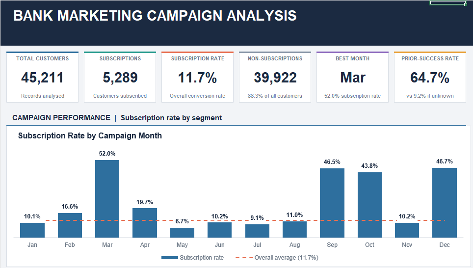
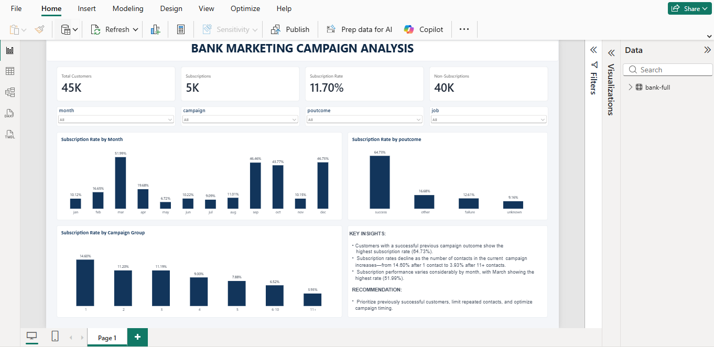

# Bank Marketing Campaign Performance & Customer Subscription Analysis

## Project Overview

An end-to-end data analytics project analyzing bank marketing campaign performance and customer term-deposit subscription behavior using **Microsoft Excel** and **Power BI**.

The project explores customer characteristics, campaign contact frequency, previous campaign outcomes, and campaign timing to identify subscription patterns and derive actionable business recommendations.

## Business Problem

Bank marketing campaigns involve contacting customers to promote term deposits, but response rates vary considerably across customer segments and campaign interactions.

The objective of this project is to analyze historical campaign data to identify patterns in customer subscription behavior, evaluate campaign performance, and uncover insights that can support more effective marketing strategies.

## Objectives

- Analyze customer characteristics associated with term-deposit subscriptions.
- Evaluate the relationship between campaign contact frequency and subscription rates.
- Examine previous campaign outcomes and their relationship with current subscriptions.
- Identify customer segments with higher subscription rates.
- Generate actionable insights and business recommendations.

## Dataset

- **Source:** UCI Machine Learning Repository – Bank Marketing
- **Dataset:** `bank-full.csv`
- **Records:** 45,211
- **Input Features:** 16
- **Target Variable:** `y` (term-deposit subscription: Yes/No)

Dataset source: [UCI Bank Marketing Dataset](https://doi.org/10.24432/C5K306)

## Tools Used

- Microsoft Excel
- Power BI
- Data cleaning and validation
- Exploratory Data Analysis (EDA)
- Data visualization
- Customer segmentation
- KPI analysis

## Key Performance Indicators

- Total Customers
- Total Subscriptions
- Subscription Rate
- Non-Subscriptions

## Dashboard Previews

### Excel Dashboard



### Power BI Dashboard



## Key Findings

- The overall term-deposit subscription rate was **11.70%**.
- Customers with a successful previous campaign outcome exhibited a substantially higher subscription rate.
- Subscription rates generally declined as the number of contacts during the current campaign increased.
- Subscription behavior varied considerably across campaign months.
- Customer characteristics and previous campaign interactions revealed differences in subscription propensity across segments.

## Business Recommendations

- Prioritize customer segments with stronger historical subscription responses.
- Avoid excessive repeated contacts and evaluate campaign contact frequency.
- Use previous campaign outcomes to inform customer targeting.
- Consider campaign timing when planning marketing activities.
- Monitor segment-level subscription rates to refine campaign strategies.

## Project Structure

```text
Bank-Marketing-Campaign-Analysis/
│
├── Dashboard_Screenshots/
│   ├── Excel_Dashboard.png
│   └── PowerBI_Dashboard.png
│
├── Data/
│   ├── bank-full.csv
│   └── bank-names.txt
│
├── Documentation/
│   ├── 01_Business_Problem_Statement.txt
│   ├── 02_Dataset_Information.txt
│   ├── 03_Data_Dictionary.txt
│   ├── 04_Data_Cleaning_Log.txt
│   └── 05_EDA_Findings.txt
│
├── Excel/
│   └── Bank_Marketing_Working.xlsx
│
├── Power BI/
│   └── Bank_Marketing_Working_Analysis.pbix
│
├── .gitignore
└── README.md
```

## Disclaimer

This project explores patterns and associations within historical marketing data. The findings do not establish causation. Campaign duration is a post-contact variable and should not be treated as a pre-campaign targeting feature.

---

*Created as a data analytics portfolio project.*
